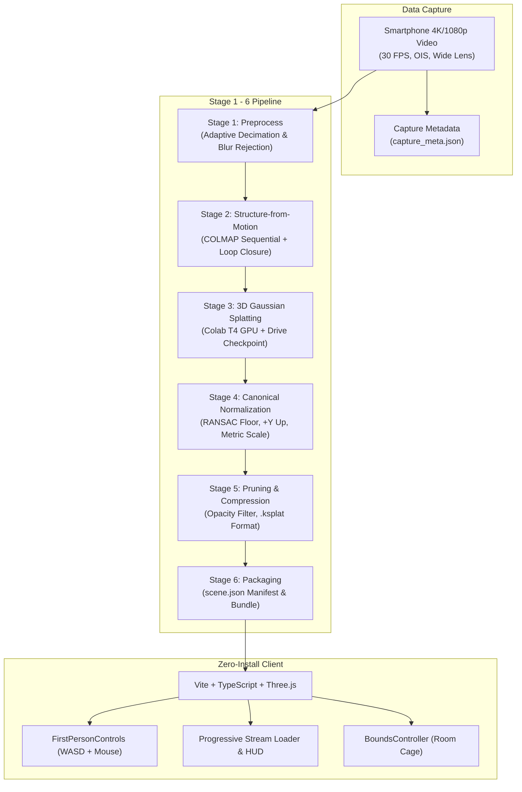

# VYTRIX Architecture Deep-Dive

**Project:** VYTRIX  
**Team:** VYTRO SQUAD  
**Competition:** Techfest 2026-27, IIT Bombay (Namma Space — Round 1)  

---

## 1. System Overview

VYTRIX bridges physical indoor spaces and interactive web computing through a high-performance, 6-stage reconstruction pipeline and a zero-install Three.js web application.

---

## 2. Mathematical Formulations

### 2.1. Blur Detection (Laplacian Variance)
To discard frames contaminated by motion blur, we evaluate the variance of the 2D discrete Laplacian operator applied to the grayscale intensity image $I(x, y)$:
$$\nabla^2 I = \frac{\partial^2 I}{\partial x^2} + \frac{\partial^2 I}{\partial y^2}$$
$$\text{Score}(I) = \text{Var}(\nabla^2 I) = \frac{1}{N} \sum_{x, y} \left( \nabla^2 I(x, y) - \mu_{\nabla^2} \right)^2$$
Frames with $\text{Score}(I) < 100.0$ are automatically dropped from the SfM matching set.

### 2.2. Gravity Alignment & Rodrigues Rotation
Given a floor plane detected via RANSAC with unit normal $\vec{n} = [a, b, c]^\top$, we calculate the rotation matrix $\mathbf{R} \in \mathrm{SO}(3)$ aligning $\vec{n}$ with the target up-vector $\vec{u} = [0, 1, 0]^\top$:
$$\vec{v} = \vec{n} \times \vec{u}, \quad s = \|\vec{v}\|, \quad c = \vec{n} \cdot \vec{u}$$
$$[\vec{v}]_\times = \begin{bmatrix} 0 & -v_z & v_y \\ v_z & 0 & -v_x \\ -v_y & v_x & 0 \end{bmatrix}$$
$$\mathbf{R} = \mathbf{I} + [\vec{v}]_\times + [\vec{v}]_\times^2 \left( \frac{1 - c}{s^2} \right)$$

### 2.3. Metric Scaling & Floor Offset
Using a real-world measured distance $d_{\text{real}}$ (from our $1.00\text{ m}$ floor reference) and the reconstructed distance between the same two points $d_{\text{SfM}}$, the uniform scale factor is:
$$s_{\text{metric}} = \frac{d_{\text{real}}}{d_{\text{SfM}}}$$
The vertical floor elevation $Y_{\text{floor}}$ is translated such that the floor plane lies at $Y = 0$:
$$\mathbf{p}_{\text{canonical}} = \mathbf{R} (s_{\text{metric}} \cdot \mathbf{p}_{\text{raw}}) - [0, Y_{\text{floor}}, 0]^\top$$

---

## 3. Web Viewer Engineering

1. **Memory Containment:** Splat sorting runs off the main browser thread inside multi-threaded Web Workers.
2. **Progressive Streaming:** Assets are fetched chunk-by-chunk using HTTP range requests and typed ArrayBuffers.
3. **Decoupled Architecture:** EventBus coordinates telemetry, pointer lock states, and UI elements, ensuring zero lock-in for future Round 2 navigation and POI overlays.
